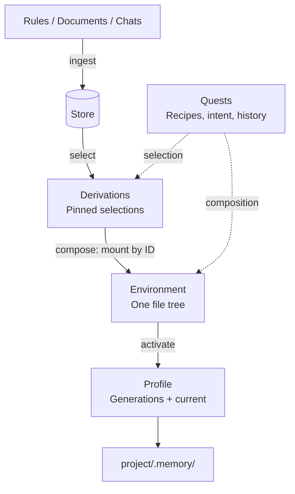

# Memix

**Reproducible, versioned memory for AI agents.**

Inspired by Nix, Memix turns rules, documents, and past conversations into
reusable context with stable identities. Select the sources once, compose them
for a project, and let agents read the result as ordinary files under `.memory/`.

## Architecture



| Object | Responsibility |
| --- | --- |
| **Store** | Keeps immutable SHA-256 blobs in versioned trees, separately for `rules`, `documents`, and `chat`. Edits reuse unchanged subtrees; previous generations remain readable. |
| **Derivation** | Freezes a selection of files, their source generations, blob identities, and provenance. Each selection can be read independently and reused across projects. |
| **Environment** | Mounts one or more Derivations into a single file tree. Composition references existing Derivations; it does not create a combined Derivation. |
| **Quest** | Records a selection or composition recipe, searchable intent, result history, and CLI usage receipts. Selection freshness is checked on demand against source generations. |
| **Profile** | Binds an Environment to a workspace through numbered activations and a movable `current` pointer, supporting explicit upgrades and rollback. |

**Selection and composition are separate.** Two projects can share a Derivation
but mount it differently. Changing a mount or replacing a Derivation creates a
new Environment; existing views keep their identities and contents.

Store updates do not silently change delivered memory. Refresh the selection,
compose a new Environment, then activate it. A Profile can roll back to a
previously activated Environment without reselecting sources.

The Store's read-only `latest/` projection supports discovery with ordinary
filesystem tools. Built views pin their inputs instead of following that live
projection.

**Current scope:** raw file-tree selection, composition, explicit refresh, and
activation. Generated summaries/embeddings, semantic conflict resolution, and
proactive invalidation are not implemented. Composition rejects path collisions
instead of silently overriding files.

## Build

Requires **C++23, CMake 4.4+, and Ninja**. Run `nix develop` first for the pinned
Linux/macOS toolchain. These commands build the current source tree:

```bash
cmake -G Ninja -S . -B build -DCMAKE_BUILD_TYPE=Release
cmake --build build --parallel
ctest --test-dir build --output-on-failure
```

The CLI is `build/bin/Release/memix`. Prebuilt binaries are available under
[Releases](https://github.com/MrZLeo/memix/releases); for agent setup, see
[the installation guide](AGENT_INSTALL.md).

## Try it

After building, run this Bash example from the repository root (`jq` required).
It uses a temporary Store and workspace without changing your existing memory.

```bash
demo="$(mktemp -d)"
(
  set -euo pipefail
  export PATH="$PWD/build/bin/Release:$PATH"
  export MEMIX_STORE_HOME="$demo/store"

  memix store ingest --type rules --dest project/AGENTS.md AGENTS.md
  d=$(memix view select --source rules/project/ --intent "Project rules" \
    --json | jq -er '.result.id')
  e=$(memix view compose --mount "$d" --intent "Project context" \
    --json | jq -er '.result.id')
  memix view activate "$e" --into "$demo/.memory"
)
```

Read `$demo/.memory/README.md` for the context guide. The selected file is at
`$demo/.memory/rules/project/AGENTS.md`.

## Documentation

- [CLI reference](skill/memix-cli/references/cli.md)
- [Profiles and rollback](skill/memix-cli/references/profiles-and-recovery.md)
- [Development and contributing](CONTRIBUTING.md)
- [BSD 3-Clause license](LICENSE)
